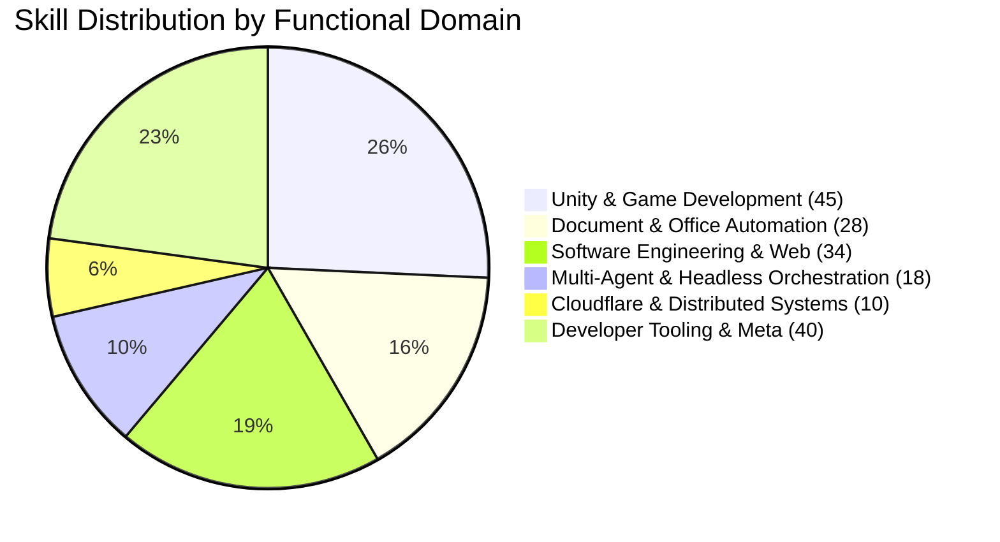

# Unified AI Agent Skill Taxonomy & Registry

This document classifies all **175 skills** collected and engineered within the `E:\Projects\Skills` repository across functional domains and provider ecosystems.

---

## 1. High-Level Summary by Domain

---

## 2. Categorized Domain Index

### A. Headless CLI Runners (`skills/headless/`)
- `codex-headless`: Programmatic execution of OpenAI Codex via `codex exec`.
- `agy-headless`: Programmatic execution of Google Antigravity via `agy -p`.
- `claude-headless`: Programmatic execution of Anthropic Claude Code via `claude -p`.

### B. Multi-Agent & Governance Process (`skills/multi-agent-process/`)
- `thub-messenger`: Inter-session messaging via Trishul Agent Hub (`thub`).
- `multi-agent-orchestrator`: Cross-provider routing and quota governance.
- `standing-gate-verifier`: FastCompile, EditMode/PlayMode testing, XML parsing.
- `clean-git-committer`: Git hygiene, zero AI attribution, decision logging.
- `review-coverage-auditor`: Rigorous state review coverage classification.
- `sim-contract-auditor`: Simulation determinism and memory allocation audits.

### C. Antigravity Ecosystem (`skills/collected/antigravity/`)
- **Core Orchestration**: `engineering-orchestrator`, `pr-handoff-lifecycle`, `pair-gate-verification`, `handoff`.
- **Simulation & Invariants**: `sim-contract-audit`, `snapshot-replay-verifier`.
- **Unity Diagnostics**: `unity-log-inspector`, `unity-testing-workflow`.
- **Platform Builtins**: `agy-customizations`, `antigravity_guide`, `automation`, `generative_ui`, `migrate-workflows`, `permissioned-github`, `plugin`, `run-workflow`, `ui-plugin-navigation`.
- **Web & SDK**: `google-antigravity-sdk`, `chrome-extensions`, `modern-web-guidance`.

### D. OpenAI Codex Ecosystem (`skills/collected/codex/`)
- **System Skills**: `imagegen`, `openai-docs`, `review-agent`, `skill-creator`, `skill-installer`.
- **Git & Automation**: `github-pr-comment-watcher`.
- **In-App Browser & Computer Use**: `control-in-app-browser`, `computer-use`, `unified-computer-use`, `visualize`.
- **Cloudflare Suite**: `agents-sdk`, `cloudflare-durable-objects`, `cloudflare-workers`, `turnstile`, `wrangler`, `workers-ai`, `web-performance`.
- **Design & UI**: `entry-stitch-design`, `stitch-design`.
- **Document Suite**: `documents`, `pdf`, `presentations`, `excel-live-control`, `spreadsheets`, `template-creator`.
- **Artifact Templates (19)**: Analytics dashboard, business review, design report, experiment result, financial model, investment memo, legal memo, market trends, operating model, project kickoff, sales pipeline, strategy memo, system design, etc.
- **Unity Suite (31)**: Audio mixers, GTK build, live game build, editor search, IAP, AI navigation, LevelPlay, localization, sprite atlas, BIRP to URP migration, new project, audio optimization, TMP optimization, web optimization, 3D physics, multiplayer, Vivox voice, shader graph nodes, sprite editor, tilemap palettes, rule tiles, IMGUI/UGUI/UITK, Unity CLI, package management, URP post-processing, render graph features.

### E. Anthropic Claude Ecosystem (`skills/collected/claude/`)
- **CLI Wrappers**: `agy-cli`, `codex-cli`.
- **Core Synced Skills**: `built-in-browser`, `chrome-browser`, `computer-use`, `deep-research`, `docs`, `docx`, `google-workspace`, `import-memory`, `morning`, `pdf`, `pptx`, `skill-creator`, `xlsx`.
- **LSP Plugins**: `csharp-lsp`, `clangd-lsp`, `gopls-lsp`, `jdtls-lsp`, `kotlin-lsp`, `lua-lsp`, `php-lsp`, `pyright-lsp`, `ruby-lsp`, `rust-analyzer-lsp`, `swift-lsp`, `typescript-lsp`.
- **Development & Lifecycle**: `code-review`, `code-modernization`, `code-simplifier`, `feature-dev`, `frontend-design`, `hookify` (writing-rules), `mcp-server-dev` (build-mcp-app, build-mcp-server, build-mcpb), `plugin-dev`, `project-artifact`, `receipts`, `session-report`.
- **Math & Hardware**: `math-olympiad`, `math-proof` (`siege`, `solo`), `cardputer-buddy`, `m5-onboard`.
- **Messaging**: `discord`, `imessage`, `telegram`.

### F. Project-Specific Skills (`skills/collected/projects/`)
- `tte-spec-step`: Test-first phase step batch implementation loop for TTE.
- `tte-unity-test`: Concise batchmode Unity test runner for TTE.
- `tte-phase-evidence`: Structured phase acceptance evidence generator.
- `tte-golden-recapture`: Re-baselining golden simulation replay recordings.
- `tte-content-asset`: Vehicle and infantry catalog asset ingestion.
- `cloud-role-bridge`: Connecting local orchestrator to persistent cloud role sessions.
