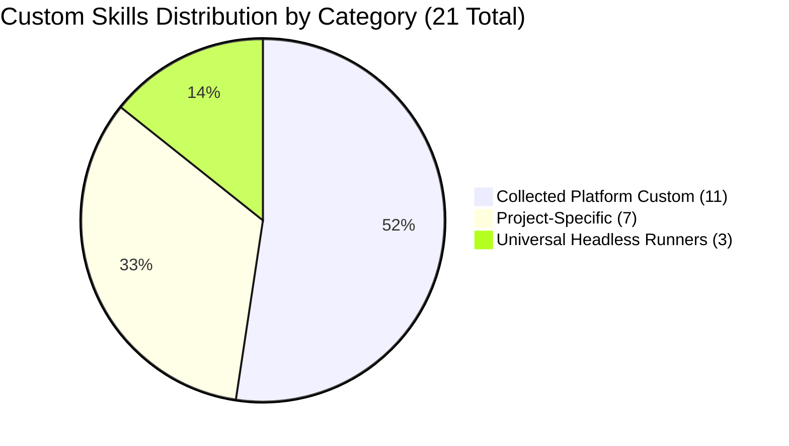

# Custom Agent Skills Registry & Taxonomy

This document catalogs and classifies the **21 custom skills and scripts** created by agents on this machine across Claude, Codex, Antigravity, and active projects (`trishul-tactical-engine`, `trishul-agent-hub`, `agent-control-plane`). All generic vendor-bundled, official marketplace, and speculative skills have been removed.

---

## 1. High-Level Summary by Category

---

## 2. Categorized Skill Inventory

### A. Universal Headless CLI Runners (`skills/headless/`)
*Custom Python runners with process tree supervision, telemetry, and Windows command-line limit handling.*
1. **[`codex-headless`](file:///E:/Projects/Skills/skills/headless/codex-headless/SKILL.md)**: Universal runner for `codex exec` (model selection, effort, sandboxing, schemas, worktrees, thread resumption).
2. **[`agy-headless`](file:///E:/Projects/Skills/skills/headless/agy-headless/SKILL.md)**: Universal runner for `agy -p` (model selection, effort, modes, output formatting, transparent file pointers for long briefs).
3. **[`claude-headless`](file:///E:/Projects/Skills/skills/headless/claude-headless/SKILL.md)**: Universal runner for `claude -p` (model tiers, allowed tools, system prompts, decoupled stdin, bare execution).

---

### B. Collected Platform Custom Skills (`skills/collected/`)
*Custom skills and scripts developed on this machine across Antigravity, Codex, and Claude.*
1. **[`agy-cli`](file:///E:/Projects/Skills/skills/collected/agy-cli/SKILL.md)**: Antigravity task runner (`scripts/agy_task.py`) for delegating tasks from Claude to `agy`.
2. **[`codex-cli`](file:///E:/Projects/Skills/skills/collected/codex-cli/SKILL.md)**: Codex task runner (`scripts/codex_task.py`) for delegating tasks from Claude to `codex exec`.
3. **[`engineering-orchestrator`](file:///E:/Projects/Skills/skills/collected/engineering-orchestrator/SKILL.md)**: Multi-agent orchestration, canonical roles (Architect, Implementor, Reviewer, Executor), subagent lifecycle, compute governance.
4. **[`github-pr-comment-watcher`](file:///E:/Projects/Skills/skills/collected/github-pr-comment-watcher/SKILL.md)**: PR comment polling, role routing, and watcher daemon (`scripts/gh_watch.py`, `scripts/pr_handoff_router_poll.py`).
5. **[`github-pr-git-workflow`](file:///E:/Projects/Skills/skills/collected/github-pr-git-workflow/SKILL.md)**: Safe PR comments via `scripts/gh_helper.py`, git clean status, exact SHA matching, fast-forward pushing.
6. **[`pair-gate-verification`](file:///E:/Projects/Skills/skills/collected/pair-gate-verification/SKILL.md)**: Running and aggregating composite Pair Gates (A/B) via `scripts/pair_gate.py`.
7. **[`pr-handoff-lifecycle`](file:///E:/Projects/Skills/skills/collected/pr-handoff-lifecycle/SKILL.md)**: Drafting and verifying PR role handoffs from git history, diffs, and NUnit reports via `scripts/handoff.py`.
8. **[`sim-contract-audit`](file:///E:/Projects/Skills/skills/collected/sim-contract-audit/SKILL.md)**: Static analysis scanner `scripts/sim_audit.py` checking for `UnityEngine.Random`, `Transform` in Runtime, LINQ, and GC allocations.
9. **[`snapshot-replay-verifier`](file:///E:/Projects/Skills/skills/collected/snapshot-replay-verifier/SKILL.md)**: Verifying snapshot serialization and state hasher equivalence via `scripts/verify_snapshots.py`.
10. **[`unity-log-inspector`](file:///E:/Projects/Skills/skills/collected/unity-log-inspector/SKILL.md)**: Inspecting and filtering Unity Editor logs (`Editor.log`, `upm.log`) via `scripts/inspect_unity_logs.py`.
11. **[`unity-testing-workflow`](file:///E:/Projects/Skills/skills/collected/unity-testing-workflow/SKILL.md)**: Running Unity tests and parsing NUnit report XMLs via `scripts/run_unity_tests.py`.

---

### C. Project-Specific Skills (`skills/projects/`)
*Custom skills residing inside repository trees.*
1. **[`cloud-role-bridge`](file:///E:/Projects/Skills/skills/projects/cloud-role-bridge/SKILL.md)**: Persistent cloud ChatGPT session bridge (`scripts/bridge.mjs`, `bridge-lib.mjs`) for agent-control-plane.
2. **[`handoff`](file:///E:/Projects/Skills/skills/projects/handoff/SKILL.md)**: File-based handoff worker for trishul-agent-hub.
3. **[`tte-content-asset`](file:///E:/Projects/Skills/skills/projects/tte-content-asset/SKILL.md)**: Content catalog and vehicle/infantry asset ingestion for TTE.
4. **[`tte-golden-recapture`](file:///E:/Projects/Skills/skills/projects/tte-golden-recapture/SKILL.md)**: Re-baselining and validating golden simulation replay recordings for TTE.
5. **[`tte-phase-evidence`](file:///E:/Projects/Skills/skills/projects/tte-phase-evidence/SKILL.md)**: Generating structured phase acceptance evidence blocks for TTE.
6. **[`tte-spec-step`](file:///E:/Projects/Skills/skills/projects/tte-spec-step/SKILL.md)**: Test-first phase spec step implementation loop for TTE.
7. **[`tte-unity-test`](file:///E:/Projects/Skills/skills/projects/tte-unity-test/SKILL.md)**: High-speed batchmode Unity test execution for TTE.
