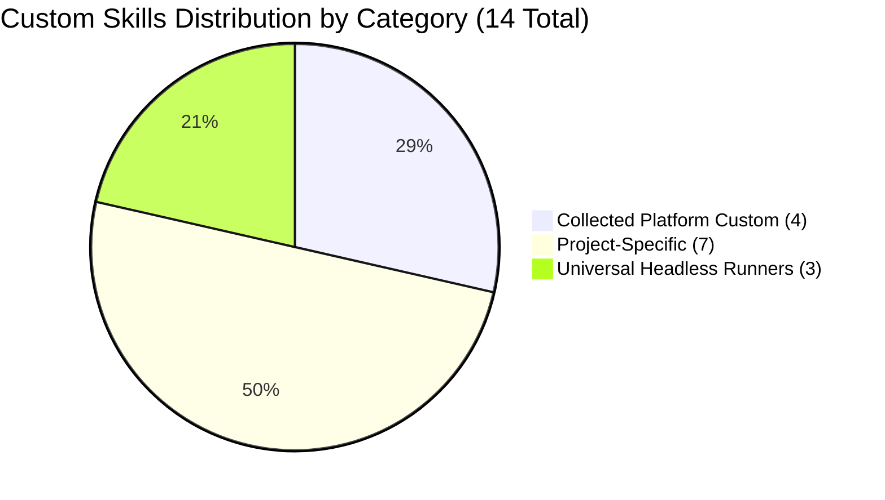

# Custom Agent Skills Registry & Taxonomy

This document catalogs and classifies the **14 high-leverage custom skills and script-backed harnesses** created by agents on this machine across Claude, Codex, Antigravity, and active projects (`trishul-tactical-engine`, `trishul-agent-hub`, `agent-control-plane`). All generic vendor-bundled, official marketplace, and duplicate speculative skills have been purged or consolidated.

---

## 1. High-Level Summary by Category

---

## 2. Categorized Skill Inventory

### A. Universal Headless CLI Runners (`skills/headless/`)
*Custom Python runners (`stdlib`-only) with process tree supervision (`taskkill /T /F`), Windows CLI limit safety (>16k chars transparent file pointer fallback), telemetry, and stream decoupling.*
1. **[`codex-headless`](file:///E:/Projects/Skills/skills/headless/codex-headless/SKILL.md)**: Universal runner for `codex exec` (model selection, reasoning effort, sandboxing, schemas, worktrees, thread resumption).
2. **[`agy-headless`](file:///E:/Projects/Skills/skills/headless/agy-headless/SKILL.md)**: Universal runner for `agy -p` (model selection, reasoning effort, auto-approve, structured output formatting, long brief pointer fallback).
3. **[`claude-headless`](file:///E:/Projects/Skills/skills/headless/claude-headless/SKILL.md)**: Universal runner for `claude -p` (model tiers, allowed tools, system prompts, decoupled stdin bypasses 3s stall, bare execution).

---

### B. Consolidated Platform Custom Skills (`skills/collected/`)
*High-leverage, script-backed tools consolidating multi-turn manual processes into single-turn automated workflows.*
1. **[`engineering-orchestrator`](file:///E:/Projects/Skills/skills/collected/engineering-orchestrator/SKILL.md)**: Multi-agent orchestration, canonical roles (Architect, Implementor, Reviewer, Executor), subagent lifecycle, compute governance.
2. **[`github-pr-workflow`](file:///E:/Projects/Skills/skills/collected/github-pr-workflow/SKILL.md)**: Unified GitHub PR operations consolidating `github-pr-comment-watcher` and `github-pr-git-workflow` into pure-Python REST API tooling (`scripts/gh_helper.py`), daemon polling (`scripts/gh_watch.py`), and git fast-forward safety checks.
3. **[`pr-handoff-lifecycle`](file:///E:/Projects/Skills/skills/collected/pr-handoff-lifecycle/SKILL.md)**: Drafting and verifying structured PR role handoffs (`[IMPLEMENTOR-1]`, `[COORDINATOR]`, `[REVIEWER-1A/B]`) directly from git history, diffs, and NUnit reports via `scripts/handoff.py`.
4. **[`unity-pipeline`](file:///E:/Projects/Skills/skills/collected/unity-pipeline/SKILL.md)**: Unified pipeline consolidating `sim-contract-audit`, `snapshot-replay-verifier`, `unity-log-inspector`, `pair-gate-verification`, and `unity-testing-workflow` into `scripts/unity_pipeline.py`. Features mandatory `<1s` static pre-check, fast C# compilation, batchmode testing, NUnit 3 XML report parsing, failure log extraction, and composite Pair Gates.

---

### C. Project-Specific Skills (`skills/projects/`)
*Custom skills residing inside repository trees, backed by executable scripts.*
1. **[`chatgpt-role-bridge`](file:///E:/Projects/Skills/skills/projects/chatgpt-role-bridge/SKILL.md)**: Persistent cloud ChatGPT session bridge (`scripts/bridge.mjs`, `bridge-lib.mjs`, `acp-loader.mjs`) enabling Antigravity to communicate with cloud roles (`DESIGN_OWNER`, `REVIEWER`) via CDP.
2. **[`handoff`](file:///E:/Projects/Skills/skills/projects/handoff/SKILL.md)**: File-based handoff worker for `trishul-agent-hub`.
3. **[`tte-content-asset`](file:///E:/Projects/Skills/skills/projects/tte-content-asset/SKILL.md)**: Content catalog and vehicle/infantry asset ingestion for TTE.
4. **[`tte-golden-recapture`](file:///E:/Projects/Skills/skills/projects/tte-golden-recapture/SKILL.md)**: Re-baselining and validating golden simulation replay recordings for TTE.
5. **[`tte-phase-evidence`](file:///E:/Projects/Skills/skills/projects/tte-phase-evidence/SKILL.md)**: Generating structured phase acceptance evidence blocks for TTE.
6. **[`tte-spec-step`](file:///E:/Projects/Skills/skills/projects/tte-spec-step/SKILL.md)**: Test-first phase spec step implementation loop for TTE.
7. **[`tte-unity-test`](file:///E:/Projects/Skills/skills/projects/tte-unity-test/SKILL.md)**: High-speed batchmode Unity test execution for TTE.
