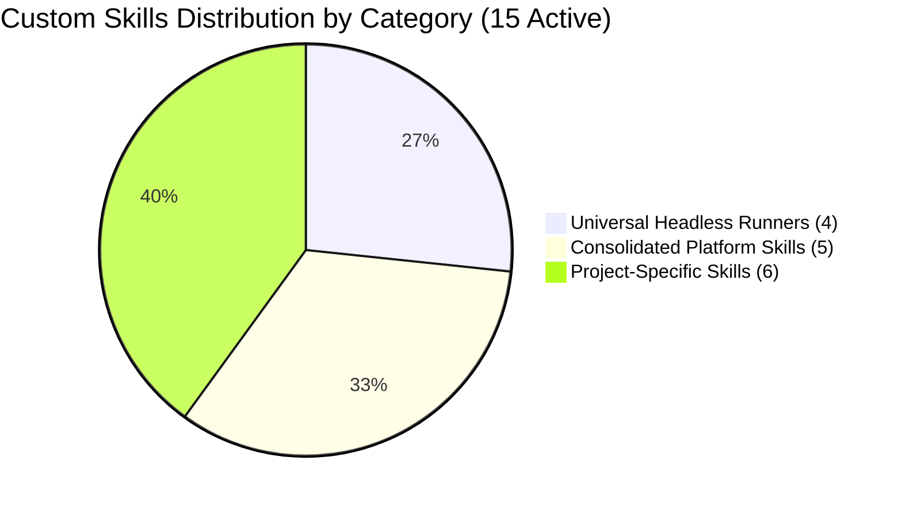

# Custom Agent Skills Registry & Taxonomy

This document catalogs and classifies the **15 active custom skills and script-backed harnesses** maintained in this repository across Claude, Codex, Antigravity, and active projects (`trishul-tactical-engine`, `tte-art-staging`, `agent-control-plane`). All generic vendor-bundled, official marketplace, and duplicate speculative skills have been purged or consolidated (with **9 retired skills** preserved under `skills/archive/`).

---

## 1. High-Level Summary by Category

---

## 2. Categorized Skill Inventory

### A. Universal Headless CLI Runners (`skills/`)
*Custom Python runners (`stdlib`-only) directly under `skills/` with process tree supervision (`taskkill /T /F`), Windows CLI limit safety (>16k chars transparent file pointer fallback), telemetry, and stream decoupling.*
1. **[`agy-headless`](../skills/agy-headless/SKILL.md)**: Universal runner for `agy -p` (model selection, reasoning effort, auto-approve, structured output formatting, long brief pointer fallback).
2. **[`agy-wsl-headless`](../skills/agy-wsl-headless/SKILL.md)**: WSL runner for `agy -p` with native `swarm` orchestration, Windows-to-WSL path translation, and quote-safe stdin dispatch.
3. **[`claude-headless`](../skills/claude-headless/SKILL.md)**: Universal runner for `claude -p` (model tiers, allowed tools, system prompts, decoupled stdin bypasses 3s stall, bare execution).
4. **[`codex-headless`](../skills/codex-headless/SKILL.md)**: Universal runner for `codex exec` (model selection, reasoning effort, sandboxing, schemas, worktrees, thread resumption).

---

### B. Consolidated Platform Skills (`skills/`)
*High-leverage, script-backed tools consolidating multi-turn manual processes into single-turn automated workflows directly in the root skills directory.*
1. **[`agent-delivery`](../skills/agent-delivery/SKILL.md)**: One-driver multi-model delivery workflow, brief templates, cross-provider review rules, and `.local/delivery/runlog.jsonl` runlog.
2. **[`agy-quota`](../skills/agy-quota/SKILL.md)**: Real-time Antigravity rate-limit, credit pool, and per-model quota checker against the local language server.
3. **[`codex-quota`](../skills/codex-quota/SKILL.md)**: Non-interactive OpenAI Codex rate-limit and rolling window checker via `codex app-server --stdio`.
4. **[`github-pr-workflow`](../skills/github-pr-workflow/SKILL.md)**: Unified GitHub PR operations consolidating pure-Python REST API tooling (`scripts/gh_helper.py`), role watcher (`scripts/gh_watch.py`), handoff poller (`scripts/pr_handoff_router_poll.py`), CI failure digests, `ci wait`, and git verification.
5. **[`unity-pipeline`](../skills/unity-pipeline/SKILL.md)**: Unified Unity C# pipeline (`scripts/unity_pipeline.py`) featuring `OSLock` advisory machine-wide locking, exact `ProjectVersion` editor resolution, `<1s` static pre-check, fast C# compilation, batchmode testing, NUnit 3 XML report parsing, failure log extraction, and composite phase gates.

---

### C. Project-Specific Skills (`skills/projects/`)
*Custom skills tailored to specific repositories and asset/delivery pipelines, backed by executable scripts where applicable.*
1. **[`chatgpt-role-bridge`](../skills/projects/chatgpt-role-bridge/SKILL.md)**: Persistent cloud ChatGPT session bridge (`scripts/bridge.mjs`, `bridge-lib.mjs`, `acp-loader.mjs`) enabling Antigravity to communicate with cloud roles (`DESIGN_OWNER`, `REVIEWER`) via CDP.
2. **[`ingest-staging-zips`](../skills/projects/ingest-staging-zips/SKILL.md)**: Automated intake, validation, atomic extraction, and split for `*_TTE_Staging.zip` asset packages between `military_assets` and `tte-art-staging` (`scripts/process_zips.py`).
3. **[`tte-asset-pipeline`](../skills/projects/tte-asset-pipeline/SKILL.md)**: End-to-end external art asset workflow for TTE (requirements publishing, read-only delivery checks, Unity import, and playable checklist).
4. **[`tte-content-pipeline`](../skills/projects/tte-content-pipeline/SKILL.md)**: Fast offline register JSON validator, unit vocabulary checker, and 32-bit FNV-1a collision auditor for TTE (`scripts/validate_content_asset.py`).
5. **[`tte-golden-recapture`](../skills/projects/tte-golden-recapture/SKILL.md)**: Re-baselining and validating golden simulation replay recordings for TTE.
6. **[`tte-phase-evidence`](../skills/projects/tte-phase-evidence/SKILL.md)**: Automated acceptance evidence block generator auditing preconditions, step commit tables, CI status, and state changes (`scripts/assemble_phase_evidence.py`).
