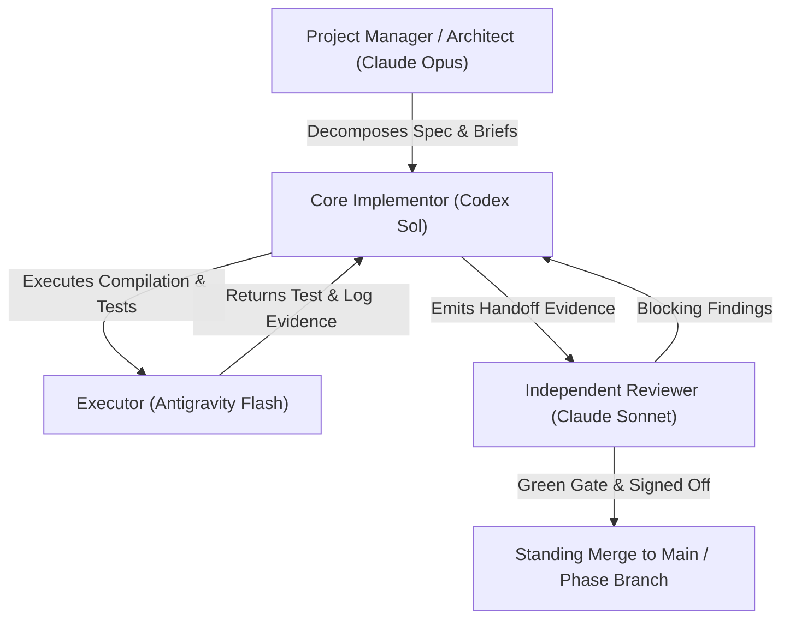

# Multi-Agent Engineering Orchestrator

This skill provides the operational rules, role specialization taxonomy, quota governance policies, and handoff protocols for multi-provider agent swarms (combining Claude, OpenAI Codex, and Google Antigravity).

## 1. Provider Specialization Matrix

| Role | Preferred Model & Provider | Core Responsibility | Anti-Patterns (Never Do) |
|---|---|---|---|
| **Architect / PM** | Claude Opus / Claude Sonnet | High-level system design, milestone planning, spec amendment, binding decisions | Deep loop-level coding; burning quota on mechanical tasks |
| **Core Implementor** | Codex Sol (`gpt-6.1-sol`) / Terra (`gpt-6.1-terra`) | Complex algorithms, simulation physics, deterministic kernel code, heavy refactoring | Accepting own code; self-reviewing merged PRs |
| **Algorithm Specialist** | Codex Astra (`gpt-6-astra`) | Linear algebra, spatial partitioning, navigation meshes, performance optimization | High-level UX styling |
| **Batch Reviewer** | Claude Sonnet / Opus (or fresh Codex) | Strict architectural compliance, contract audit, regression review at checkpoint SHA | Author reviewing own implementation; modifying code during review |
| **Mechanical Executor** | Antigravity Flash (`gemini-3.8-flash`) | Running Unity tests, compiling assemblies, inspecting log files, asset manifest generation | Designing architecture; writing core deterministic simulation kernel |

## 2. Hard Governance Rules

### Rule 1: Reviewer Independence (Zero Self-Review)
- An agent or provider that writes an implementation **must never review or approve it**.
- If Codex Sol implements batch $N$, the batch review must be executed by Claude Sonnet/Opus or a fresh isolated review subagent.

### Rule 2: Quota Optimization
- Running high-tier models (Opus / Sol-ultra) on mechanical tasks drains plan quotas in hours.
- Delegate mechanical tasks (Unity compilation, log scraping, file renaming, test running) to Antigravity Gemini Flash.

### Rule 3: Single Writer Principle
- Only one agent may hold write locks or commit to an active branch/worktree at any given time.
- All other participants operate in isolated git worktrees or read-only sandboxes.

## 3. Standardized Handoff Protocol

Every task completion must emit an unambiguous handoff block:

```markdown
### AGENT HANDOFF EVIDENCE
- **Package / Step:** <e.g., G02.08 Movement Pathfinding>
- **Commit SHA:** `<40-character SHA>`
- **Branch:** `<feature/step-branch>`
- **Author:** `<e.g., Implementor-Codex (gpt-6.1-sol / high)>`
- **Verification Gate:**
  - FastCompile: PASSED (0 errors, 0 warnings)
  - EditMode Tests: PASSED (48 passed, 0 failed)
  - PlayMode Tests: PASSED (12 passed, 0 failed)
- **Known Limitations / Gaps:** <None or explicit list>
- **Next Assigned Role:** `<e.g., Reviewer-Claude (claude-3-7-sonnet / high)>`
```

## 4. Multi-Agent Delegation Workflow


